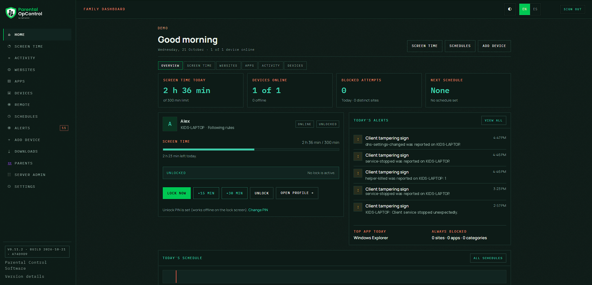
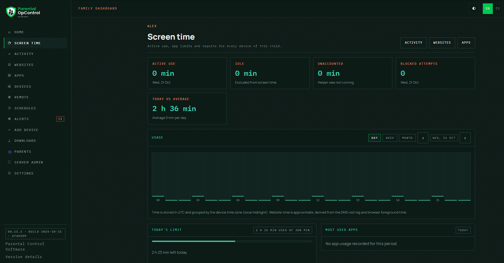
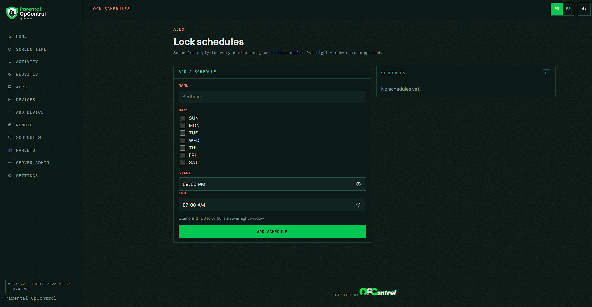
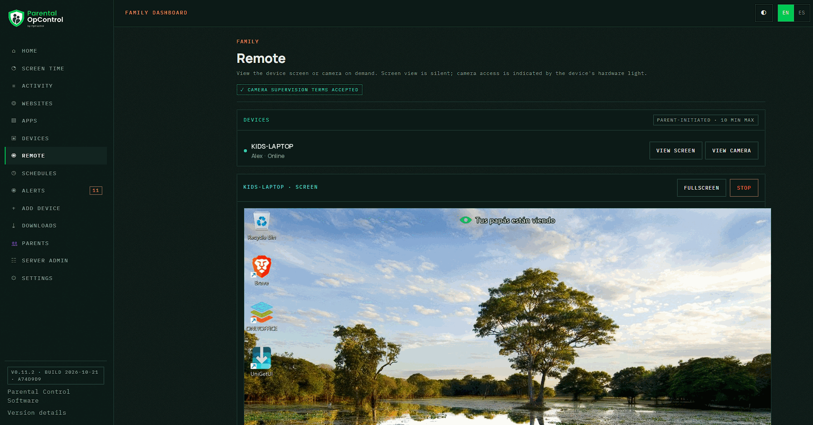

# Parental OpControl

Self-hosted parental control software for families. It has a web dashboard for parents, a Windows client for the child's computer and a guided installer. It is a ground-up rebuild of the ArktinMonitor parental control system, available in English and Spanish.



## Features

### Lock and unlock
- Lock or unlock a device instantly from the dashboard
- Full-screen lock overlay on the child's computer that keeps working offline
- Lock schedules per child, including overnight windows such as 21:00 to 07:00
- Bonus time (+15 min, +30 min or a custom amount) with a countdown banner on the child's screen
- Parent override PIN on the lock screen, with a menu to unlock until the next lock or give bonus time

### Screen time
- Active screen time per child across all of the child's devices, with idle time excluded
- Daily device limit and per-app limits that end in the lock screen
- Day, week and month usage charts, most used apps and an activity timeline

### Websites and apps
- Website filtering through a local DNS resolver on the device, with curated categories (adult, gambling)
- Visited sites history with inline block and unblock
- Installed app inventory, a review list for new apps and real-time app blocking
- Always-allowed apps and sites, plus bonus unlocks for a single blocked site or app

### Remote viewing
- Parent-initiated screen and camera viewing, up to 10 minutes per session, no audio and no recording
- Optional on-screen notice on the child's device, configurable per device
- One-time camera supervision acknowledgement per parent, plus a separate RemoteView permission

### Alerts and email
- Alerts for tampering (service stopped, helper killed, DNS changes, clock changes, uninstall attempts) and limits
- Email alerts and a daily digest, with mute per alert type and quiet hours
- Bilingual HTML emails (invitations, alerts, digest) with a plain-text version

### Families and parents
- Multiple families on one server, with invite-only registration and no public sign-up
- Co-parents with per-parent permissions; every action records which parent made it
- Two-factor authentication (TOTP) for parent accounts
- Server administrator tools and a build version shown in the dashboard

### Windows client
- MSI installer and setup wizard; parents add a device with a one-time install link or QR code
- Automatic updates with SHA-256 verification and automatic rollback
- SYSTEM service plus a user-session helper, with tamper detection and offline enforcement from a local cache

### Interface
- English and Spanish (es-MX), selected per parent, per family and per device
- Dark and light themes, built for both desktop and phone screens

## Screenshots

| Screen time | Lock schedules |
|---|---|
|  |  |



Screenshots use demo names.

## Solution

| Project | Purpose |
|---|---|
| `src/OpControl.Parental.Server` | ASP.NET Core 10, Blazor Server dashboard, API, SignalR device hub, Identity, EF Core |
| `src/OpControl.Parental.Contracts` | Platform-neutral DTOs and hub method names |
| `src/OpControl.Parental.Client.Windows` | Windows service: enrollment, credential storage, SignalR, heartbeat, offline state cache |
| `src/OpControl.Parental.Client.Windows.Helper` | User-session helper: full-screen lock window driven by the cached state |
| `src/OpControl.Parental.Setup` | Setup bootstrapper (interactive install wizard that embeds the MSI) |
| `src/OpControl.Parental.Localization` | Shared English and Spanish strings for the Windows client and setup |
| `tests/OpControl.Parental.Tests` | Model, enrollment, credential and lock-evaluation tests |

Target framework: **.NET 10 (LTS), SDK 10.0.402, runtime 10.0.13**.

## Local build and test

```bash
dotnet restore
dotnet build
dotnet test
```

## Server deployment

Stack directory on the Docker host: `/opt/stacks/opcontrol-parental/`.

- `docker-compose.yml` and `docker-compose.override.yml` (host port `127.0.0.1:8096`)
- `.env` (database password, not committed)
- `data/postgres/` persistent PostgreSQL data (back up this directory)
- `data/keys/` ASP.NET Data Protection keys (back up with the database)
- `repo/` build context

Build and redeploy (the script stamps the version, commit and build date automatically):

```bash
./deploy/build-image.sh opcontrol-parental-web
cd /opt/stacks/opcontrol-parental
docker compose up -d
```

### Staging stack

`deploy/docker-compose.staging.yml` binds the web port to `${STAGING_BIND_IP:-127.0.0.1}` and
uses the same value for `PublicBaseUrl`, so the default is loopback-only. To expose staging on
the host's Tailscale address, set it in the staging `.env` (not committed):

```bash
# /opt/stacks/opcontrol-parental-staging/.env
STAGING_BIND_IP=100.x.y.z
```

Then `cd /opt/stacks/opcontrol-parental-staging && sudo docker compose up -d`.

The image tag is `<version>-<YYYYMMDD>`. `GET /version` and `GET /health` return the same stamped
version string; the dashboard sidebar and Settings show it too. A build from an untagged commit
shows a `git describe` value such as `v0.6.0-3-g1a2b3c4`, so it is never mistaken for a release.

Fonts (IBM Plex Mono and Manrope) are self-hosted in `wwwroot/fonts` and embedded in the
Windows helper/setup; no Google Fonts runtime dependency. Licences are next to the fonts.

## Remote screen and camera

Parents with the **RemoteView** permission (owner by default) get a **Remote** page. Screen
view is silent on the child device; camera access is indicated by the device's hardware
camera light. Camera viewing requires a one-time camera supervision acknowledgement per
parent; acceptance is stored in `CameraConsents` with version, time, IP and user agent, and
a checkmark appears on the Remote page after acceptance. Sessions are parent-initiated,
last at most 10 minutes and can be stopped from the dashboard. No audio and no recording.

Server administrator and SMTP (no dashboard login needed):

```bash
docker exec parental-web dotnet OpControl.Parental.Server.dll --set-server-admin owner@example.com
# SMTP JSON on stdin; password is protected with the Data Protection keys
printf '%s' "$SMTP_JSON" | docker exec -i parental-web \
  dotnet OpControl.Parental.Server.dll --set-server-smtp-stdin
```

Only the first run creates a family (`/setup`); afterwards new families join by invitation from
the server administrator and there is no public sign-up.

Health: `GET /health`. Public URL: `https://parental.opcontrol.net` (Cloudflare Tunnel).

## Windows build host

Windows client builds run on a dedicated Windows build host, never on a monitored child device.
Everything is kept under `C:\BuildTools\opcontrol-parental`:

```powershell
# one-time setup (already done)
Invoke-WebRequest https://dot.net/v1/dotnet-install.ps1 -OutFile C:\BuildTools\opcontrol-parental\dotnet-install.ps1
& C:\BuildTools\opcontrol-parental\dotnet-install.ps1 -Version 10.0.402 -InstallDir C:\BuildTools\opcontrol-parental\dotnet -NoPath
& C:\BuildTools\opcontrol-parental\dotnet\dotnet.exe tool install wix --tool-path C:\BuildTools\opcontrol-parental\tools --version 5.0.2
& C:\BuildTools\opcontrol-parental\tools\wix.exe extension add -g WixToolset.Util.wixext/5.0.2
```

Build the client, helper, MSI and setup bootstrapper in one step:

```powershell
powershell -ExecutionPolicy Bypass -File C:\BuildTools\opcontrol-parental\repo\installer\build-windows.ps1 -Version 0.7.0
```

Artifacts land in `artifacts\OpControlParental-<version>.msi` and
`artifacts\OpControlParental-Setup-<version>.exe`. Do **not** build on a monitored child device.

## Windows client

Publish (Linux payload publish only; WiX still needs Windows):

```bash
dotnet publish src/OpControl.Parental.Client.Windows -c Release -r win-x64 -o out/client
dotnet publish src/OpControl.Parental.Client.Windows.Helper -c Release -r win-x64 -o out/helper
```

### Installer, silent install and auto-update

The Windows installer is a WiX MSI plus a small WinForms setup bootstrapper. Build commands:

```bash
# 1. Publish the Windows payloads on any OS with the .NET 10 SDK
dotnet publish src/OpControl.Parental.Client.Windows -c Release -r win-x64 -o artifacts/publish-0.5.0/client -p:Version=0.5.0
dotnet publish src/OpControl.Parental.Client.Windows.Helper -c Release -r win-x64 -o artifacts/publish-0.5.0/helper -p:Version=0.5.0

# 2. Build the MSI on Windows (WiX 5 is Windows-only)
dotnet tool install wix --tool-path C:\ocp-build\tools --version 5.0.2
powershell -ExecutionPolicy Bypass -File installer/build-msi-windows.ps1 `
  -Version 0.5.0 -PublishRoot artifacts/publish-0.5.0 `
  -OutFile artifacts/OpControlParental-0.5.0.msi -InstallerDir installer

# 3. Embed the MSI in the setup bootstrapper
dotnet publish src/OpControl.Parental.Setup -c Release -r win-x64 -o artifacts/setup-0.5.0 `
  -p:Version=0.5.0 -p:MsiPath="$PWD/artifacts/OpControlParental-0.5.0.msi"
cp artifacts/setup-0.5.0/OpControl.Parental.Setup.exe artifacts/OpControlParental-Setup-0.5.0.exe
```

`installer/build-installer.sh` publishes the payloads and documents this sequence, but WiX itself
must run on Windows. The setup bootstrapper is interactive; the MSI supports silent install:

```bat
msiexec /i OpControlParental.msi /qn SERVER=https://parental.opcontrol.net CODE=XXXXXXXXXX ACCOUNT=<child-windows-account>
OpControlParental-Setup-0.5.0.exe /S SERVER=https://parental.opcontrol.net CODE=XXXXXXXXXX ACCOUNT=<child-windows-account>
```

There is no default Windows account. Interactive setup lists non-administrator accounts first
and requires the parent to pick one; silent installs must pass `ACCOUNT=`. The pre-configured
download names the setup `OpControlParental-<CODE>.exe`; the bootstrapper reads
the one-time code from its own file name and pre-fills the dialog. The MSI writes `SERVER`, `CODE`
and `ACCOUNT` to `HKLM\Software\OpControl\Parental` on first install; the service consumes and
deletes those values on first start. Upgrades keep `C:\ProgramData\OpControlParental` (device
credential, cached state), so no re-enrollment is required.

The server serves auto-update files from `data/releases` (mounted at
`/var/lib/opcontrol-parental/releases`). Place `OpControlParental-<version>.msi` and
`OpControlParental-Setup-<version>.exe` there. The highest version with an MSI is current;
the server publishes its SHA-256. A device checks daily and whenever the dashboard requests an
update, downloads the MSI, verifies SHA-256, runs the update runner, and reports healthy. If the
new service does not write the health marker within five minutes, the runner uninstalls it with
`SUPPRESSDATA=1` and installs the previous version (keeping the credential). The dashboard shows
the client version per device and an Update now button.

Signing is optional. Set a certificate and run:

```powershell
powershell -ExecutionPolicy Bypass -File installer/sign.ps1 -CertificateThumbprint <thumbprint>
```

This signs and verifies the MSI and setup EXE with SHA-256 and a timestamp.

### Install links (Add device)

Parents create a single-use install link in Add device. The dashboard shows the link, QR code,
one-time code and copy/email buttons. The link is valid for 24 hours by default
(`FamilySettings.InstallLinkMinutes`, configurable in Settings), can be revoked, and flips to
"Connected" when the device enrolls. The public `/i/<token>` page detects phones (Android coming
soon) and offers the pre-configured setup on Windows. A manual code entry fallback remains in the
setup dialog and in the Downloads page instructions.

### Manual scripted install (legacy)

`deploy/install-legacy.ps1` and `deploy/uninstall-legacy.ps1` remain for reference, but new devices should
use the MSI/setup. The legacy installer now requires `-MonitoredAccount`; there is no default account.

The service stores the device credential in `C:\ProgramData\OpControlParental\private\device.json`
with an ACL that grants access to SYSTEM and Administrators only. The user-session helper reads
only `state.json` (Users read) and never sees the credential.

## Migration

Generate a migration:

```bash
dotnet ef migrations add <Name> --project src/OpControl.Parental.Server --startup-project src/OpControl.Parental.Server --output-dir Data/Migrations
```

The server applies pending migrations on startup.
